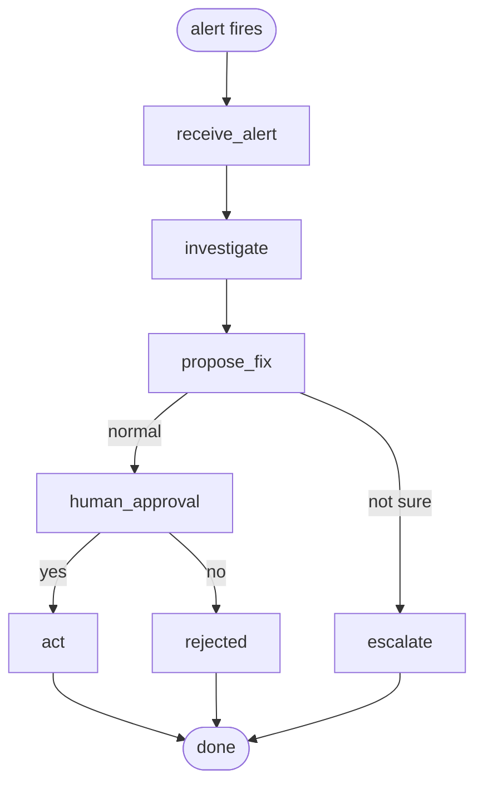

# PagePal

An on-call incident agent. When an alert fires, PagePal looks at logs, metrics
and deploys, finds the likely root cause, proposes **one** fix, and waits for a
human to approve it before doing anything.



Week 1 status: everything runs on **fake data** and actions are **simulated**
(nothing real gets restarted). Free tools only.

| Piece | What it is | Cost |
|---|---|---|
| LangGraph | the flow above, plus the pause for human approval | free, open source |
| LangChain `create_agent` | the investigator: an LLM that calls tools in a loop | free, open source |
| Groq | the LLM. 3 models; if one hits its limit, the next one is used | free tier |
| LangSmith | optional: see every step and LLM call in a web UI | free Developer plan (5k traces/month) |

## The 3 fake incidents

Each lives in `data/scenarios/<name>/` (alert, logs, metrics, deploys).

| Scenario | What broke | Expected fix |
|---|---|---|
| `bad_deploy` | v1.8.0 shipped a bug, `/api/analyze` returns 500 | `rollback_deploy` |
| `memory_leak` | worker memory grows until it gets OOMKilled | `restart_service` |
| `llm_rate_limit` | main Groq model hit its daily token limit (429) | `switch_llm_model` |

All three also contain a harmless "slow Firestore query" warning. It is there to
check that the agent ignores noise. To regenerate the data:
`uv run python scripts/make_fake_data.py`.

## Setup

1. Install [uv](https://docs.astral.sh/uv/) (a fast Python package manager):
   - Windows: `powershell -ExecutionPolicy ByPass -c "irm https://astral.sh/uv/install.ps1 | iex"`
   - Mac/Linux: `curl -LsSf https://astral.sh/uv/install.sh | sh`

   Then **open a new terminal** and check with `uv --version`.
2. Install the project:
   ```bash
   uv sync
   ```
   No uv? `python -m venv .venv && source .venv/bin/activate && pip install -e . "langgraph-cli[inmem]" pytest` works too
   (on Windows activate with `.venv\Scripts\activate`; then drop the `uv run` prefix below).
3. Add your keys:
   ```bash
   cp .env.example .env      # Windows cmd: copy .env.example .env
   ```
   Put your free Groq key in `GROQ_API_KEY` ([get one here](https://console.groq.com/keys)).
   For LangSmith traces, also set `LANGSMITH_TRACING=true` and `LANGSMITH_API_KEY`.

## Run it

**In the terminal:**

```bash
uv run pagepal bad_deploy
```

You'll see the findings and the proposed fix, then `Approve? [y/N]`.

**In LangGraph Studio (visual):**

```bash
uv run langgraph dev
```

It opens Studio in your browser. Pick the `pagepal` graph, enter
`{"scenario": "bad_deploy"}` as input, and press Submit. The run pauses at
`human_approval`; resume it with `true` (approve) or `false` (reject).

**Tests** (offline, fake LLM, no key needed):

```bash
uv run pytest
```

## Code map

| File | What it does |
|---|---|
| `src/pagepal/graph.py` | the flow: state, nodes, edges, human approval |
| `src/pagepal/tools.py` | tools the investigator can call (read fake logs/metrics/deploys) |
| `src/pagepal/llm.py` | Groq models and the fallback list |
| `src/pagepal/run.py` | terminal runner |
| `langgraph.json` | tells `langgraph dev` where the graph is |

## Safety rules (on purpose)

- The LLM can only pick from a fixed list of actions (`FixProposal.action`). It cannot invent a command.
- Nothing happens without a human "yes".
- `act` refuses to touch any service other than the one that alerted.
- Tools return short summaries, never whole log files (Groq free tier allows ~8K tokens per minute).
